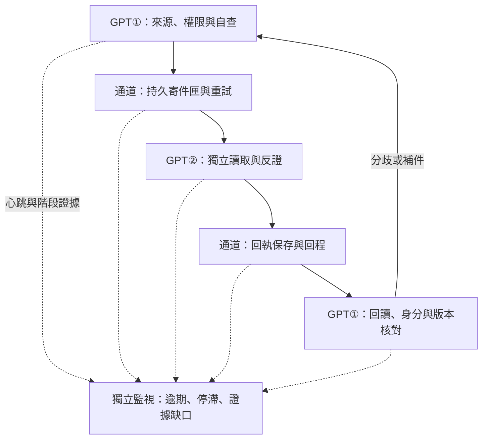

# 第一大腦｜雙端自查、傳輸監視與獨立反證 V0.1
request_id: FB-DUAL-MONITOR-20261106-001
狀態：DESIGN_CANDIDATE；actual_ack=false；BOT 統一工程審查 NOT_RECEIVED；GPT② 本輪不派送。
基準：PR #98 固定 SHA 3974a26866226e364ca5b2eb05c3a0d448f56ab5；Issue #31、#41 本文及 #41 留言。本文件為既有治理的細化候選，不替換正式規章。
來源：https://github.com/keqingwu5-cloud/ai-boundary/issues/31 、https://github.com/keqingwu5-cloud/ai-boundary/issues/41 、https://github.com/keqingwu5-cloud/ai-boundary/pull/98 。

## 1. 三區資料流

兩方向套用相同契約，角色不固定為永遠發送者。監視器只有觀察與阻擋能力，不能授權或補造成功證據。

| 區域 | 輸入 | 唯一責任與輸出 | 阻擋條件 |
|---|---|---|---|
| A 發送端 | 原始目標、完整來源、固定版本、有效授權 | 建立不可變 envelope、自查記錄、持久寄件意圖 | 來源未讀全、版本漂移、STOP、撤權、過期、無效時間、寫入失敗 |
| B 通道 | 已封存 envelope 與寄件意圖 | 每次 attempt 證據、傳輸結果、逾時及回執定位 | 不可達、權限拒絕、摘要不符、超預算；2xx 只代表通道接受 |
| C 接收端 | 實際讀取 bytes、可信來源脈絡、任務要求 | 收件證據、自查、獨立反證、審查回執 | 身分不明、版本錯誤、資料不完整、重放、無法驗證來源 |
每區分開記錄。來源自查 PASS 只允許嘗試傳送；不直接導向 delivered。

## 2. 證據契約
共用必要欄位：
- project_id、task_id、request_id、event_id、correlation_id、parent_event_id（根事件明確為 null）、in_reply_to（回覆必填）、record_id。
- schema_version、payload_version、policy_version、source_revision（Git SHA 或文件 revision）、source、destination、actor_identity_ref。
- idempotency_key：project/task/direction/event/version 範圍固定；重傳不換 event 或 key，只新增 attempt_id。內容變更須新 event/version，引用 supersedes。
- digest_algorithm=SHA-256、canonicalization_version、payload_digest；明確覆蓋 envelope 業務欄位及附件 manifest，排除 digest/signature 自身。附件另核實 bytes、長度、MIME；hash 不證明身分。
- created_at、observed_at、expires_at：嚴格 RFC3339、時區必填且有限值。跨機時間不拿來單獨證明先後；以 parent/sequence 追序，單程序 deadline 用單調時鐘。漂移超設定容忍度則 HOLD。
- evidence_refs：provider/resource_type/id/canonical_url/revision/digest/read_at/access_status；分頁完整度及查詢範圍另存。找不到查詢結果不等於未發布。
- scope、grant_id、authorization_epoch：發送及外部動作前重查授權；任何重啟不能清除 STOP 或撤權。監視器不得續期 grant。
- result=PASS/HOLD/FAIL/NOT_RUN、reason_code、affected_scope、retryable、next_action、evidence_level。
審查記錄額外含 review_id、reviewer_identity_ref、subject_event_id/version/digest、self_review_id、claims、counterexamples、disagreements、unknowns、source_access、execution_status。
ACK 額外含 ack_kind（receipt 或 review）、ack_id、in_reply_to、subject_digest/version、review_digest（review 類必填）、接收端持久收據 URL/ID、驗證器版本與可信身分驗證結果。禁止將 payload 的 verified_identity=true 當認證。

## 3. 狀態與交叉反證
維持 #41 舊狀態可讀，不悄悄改語意。新增分軸候選：
- 發送：DRAFT → SELF_CHECKED → OUTBOX_COMMITTED → SEND_ATTEMPTED → TRANSPORT_ACCEPTED。
- 接收：RECEIPT_UNVERIFIED → RECEIPT_VERIFIED；只有後者才可映射新契約 delivered。
- 審查：NOT_STARTED / IN_PROGRESS / COMPLETED / DISPUTED；完成可以是拒絕，並非業務 PASS。
- 回程：ACK_PUBLISHED → ACK_OBSERVED → ACK_VERIFIED。actual_ack 僅在可信獨立接收方證據與完整綁定核對後為 true，並附 ack_kind。
- 授權與執行另列；ACK 不授權派工或部署。closed 需任務完成條件，不由 HTTP 成功導出。
舊 #41「ack_received → reviewed」可代表收件 ACK 後才審查；本輪「審查後回 ACK」使用 review ACK。兩者分型以消除順序衝突。歷史 delivered 缺接收證據時只補證據級別，不改寫歷史。
流程：①自查 → 封存 → ②獨立來源回讀、自查 → ②提出反例及分歧 → 封存回件 → ①回讀驗證 → 逐項採納/反駁/待證。返工新事件連結舊事件，雙方記錄追加保存，不覆寫。意見一致不自動提升證據等級。

## 4. 重試、責任及未知
接收端 inbox 以 key 唯一約束原子落盤，同 key 同 digest 回傳既有收據，不重做業務；同 key 異 digest 為 CONFLICT。回執遺失先查既有 inbox/review，再重傳相同事件。外部副作用結果未知禁止盲重派。
每次嘗試有 deadline、有限總次數與持久總預算、退避及抖動；進程重開不歸零。STOP 立即停止新派送，保留受限審計；遠端停止沒有回執就標 STOP_REQUESTED。
| 観測 | 分類 | 歸屬 |
|---|---|---|
| 發送自查拒絕 | SOURCE_INVALID / AUTH_BLOCKED | 發送端已確認；不責怪傳輸 |
| 通道明確拒絕請求 | TRANSPORT_REJECTED | 通道階段確認，根因可能是權限設定 |
| 2xx 後未見收件 | DELIVERY_UNKNOWN | UNKNOWN，不能推論資料遺失 |
| 接收摘要不符 | CONTENT_CONFLICT | 失敗點在接收驗證；根因未定 |
| 接收確認但審查未完成 | REVIEW_PENDING / REVIEW_STALLED | 接收端進度；不是傳輸失敗 |
| 回件存在但讀不到 | ACK_RETURN_UNKNOWN | 權限、索引或回程候選原因 |
| 舊版本或不同任務回執 | ACK_BINDING_MISMATCH | 拒絕該回執，原事件保持待證 |
每個事故記 detected_at_zone、suspected_causes、confirmed_cause、evidence、unknowns；多個原因可共存，證據不足不強行分責。

## 5. 監視器自檢
心跳需 instance_id/boot_id/sequence/observed_at；同時觀測最近進度時間、佇列年齡、收據落盤與讀回，程序存活不是進展健康。
獨立 watchdog 觀測監視器（不同程序/故障域是部署前條件）；heartbeat stale/回退、寫入失敗、來源中斷時 MONITOR_UNHEALTHY/UNKNOWN，停止受影響的新派工，保留 read-only 診斷。告警有獨立 alert_id 與投遞證據；告警通道失效保留本機待送，不聲稱使用者已收到。
watchdog 也失聯時，UI 依最後可信觀測時間自行顯示 stale，不永久綠燈；無法保證全部共同故障時即時通知。閾值、告警出口與 watchdog 運行環境尚未接線，標 NOT_RUN。

## 6. 可反證測試矩陣（未執行項一律 NOT_RUN）
| ID | 注入 | 驗收斷言 |
|---|---|---|
| T01 | 封存後修改來源 payload | 自查/接收拒絕，不接受舊 digest |
| T02 | 審查 A 搭配事件 B ACK | subject 綁定拒絕 |
| T03 | 反向事件沒有 in_reply_to 或 correlation 不符 | 不能視為同一次交換 |
| T04 | 相同內容不同 JSON key 順序 | 同 canonical digest |
| T05 | undefined/NaN/循環資料/損壞時間 | 結構化拒絕，不靜默刪欄或拋未捕捉錯誤 |
| T06 | 送前斷線、送後斷線 | 區分未送出與送達未知 |
| T07 | 重送/並行重複/重啟後重送 | 唯一 inbox 與有限預算，不重複審查副作用 |
| T08 | 已審查但 ACK 回程遺失 | 查回原回執，不重做任務 |
| T09 | 自填 verified_identity/偽造 URL/同帳號冒充 | actual_ack=false，可信驗證失敗 |
| T10 | 版本衝突/舊 ACK 重放/授權 epoch 改變 | HOLD，保留雙方證據 |
| T11 | STOP/撤權後重啟、過期或無效 expiry | 不重授權、不派工，留下理由 |
| T12 | 心跳停止、程序活但無進展、告警失效 | UNKNOWN/告警待送，不能顯示健康 |
| T13 | 不完整分頁、文件 revision 變動 | 不宣稱已讀全或不存在 |
| T14 | 雙方意見衝突、接收端拒絕 | 審查可完成且 DISPUTED，不能自動 closed |
| T15 | 收件/審查落盤後崩潰 | 恢復既有記錄、不覆寫或偽造成功 |
先保留缺陷重現，再最小修補及同反例 GREEN，移除對應保護應 Mutant RED。不可用重現腳本 PASS 冒充安全驗收 PASS。

## 7. 與既有實作差異
| 基準 | 可複用 | 尚缺／本設計處理 |
|---|---|---|
| #31 | G0/G1/G2、角色分權、停止與記錄保存 | 用三區收據落實；不變更正式核准邊界 |
| #41 | 共用入口、event/correlation/key、真實回讀要求 | 分型 receipt/review ACK；新增證據階段與責任未知 |
| #98 prepare/review | 欄位、摘要及路由初步檢查 | prepare 保留 payload 參照；JSON.stringify 與多模態 canonical 不同；審查未綁定 subject |
| #98 verifyAck | 方向/event/correlation/digest 檢查；actual_ack 永遠 false | reviewed 只檢 state，未驗 review subject；沒有可信認證 adapter/有效期/重放防護 |
| #98 exchange | 雙方向 queued 候選、event_id 不可相同 | 未強制 correlation/in_reply_to 綁定，並非已傳輸 |
| #98 多模態 | canonical JSON、圖片 bytes hash、快照修改檢查 | 可統一序列化；不等於圖片語意已驗或身分已驗 |
| #98 locator | 有限遍歷、部分讀取 fail-closed、版本核對 | 實際 runtime/自動喚醒/可信 ACK 仍須另證；本輪不評定全部部署狀態 |
未聲稱所有 #98 能力均已本地重跑；本輪只測兩個 handoff 模組與相應反例。

## 8. 自查與獨立審查交付
自查：無將自填身分當可信認證；無將 hash 當簽章；未知不歸罪通道；停止優先於重試；ACK 與核准分離；同一來源與 canonical index 不另建孤島；設計不是已接線。
依使用者最新指示，本輪先交 BOT 統一工程審查，GPT② 審查延後。BOT 請自行讀固定 SHA 與此設計，逐條回覆：claim_id / ACCEPT、REVISE、REJECT、UNKNOWN / evidence / counterexample / source_access / execution_status / disagreement / required_patch。尤其反證 T02/T03/T04 與雙端同一憑證的獨立性。
review_request 透過既有 #30 BOT 工程審查入口發布，#41 保留索引；發布不等於 BOT 收到，不以本對話代演 BOT 或 GPT②。
既有 P0 STOP/撤權與 grantAllows 修補繼續列為部署前阻擋；Gemini 第76節正式回覆已直接讀回，其程式存取 SOURCE_NOT_VERIFIED、LOCAL_EXECUTION=NOT_RUN。其複合失效鏈仍需實證，不因審查文字就當作重現。
不得建立正式憑證、部署 Agent、合併 PR、改寫正式記憶。設計與本地測試不需要再次逐步人工核准。

## 9. 本輪隔離驗證收據
執行日期 2026-11-06；固定源碼 SHA 如上。Node 既有 handoff 兩檔測試 19/19 PASS，並不覆蓋全部 PR。
另外執行三個缺陷觀察：T02 跨事件審查混搭仍進入 ack_candidate_requires_external_verification；T03 不同 correlation 且無 in_reply_to 仍為 bidirectional_queued_candidate；T04 只有物件 key 順序不同即 payload_mismatch。三個缺陷均已重現，不是三項安全通過。actual_ack 均未轉為 true。
重現命令：node tests/handoff-monitor-gap-reproduction.cjs。這個腳本斷言舊行為以保存重現；未來修補時需另加期望安全行為的負向測試，不能把此腳本 PASS 當 GREEN。
其他矩陣案例本輪未跑；工程未修改；本次無 P0 修補 RED→GREEN→Mutant RED 完成宣稱。BOT 請先比對目前整合分支是否已有修補，勿以舊 4b4fddb 快照推論最新版尚未修好。
