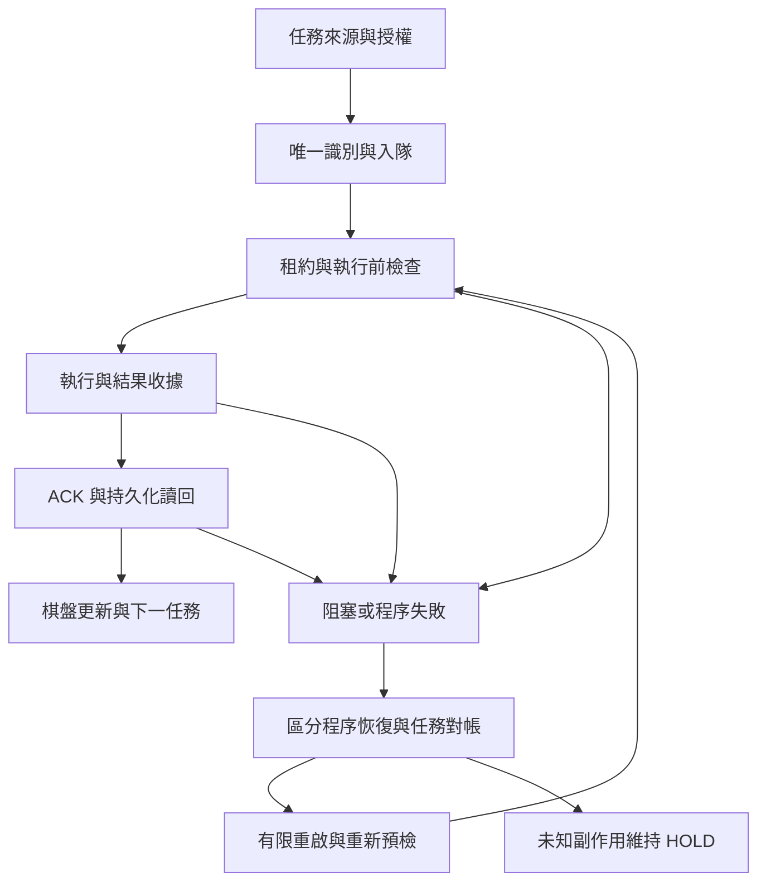

# 第一大腦｜自主運作、原子治理與世界模型整合總規格 V1.1
日期：2026-11-06（Asia/Taipei）
性質：既有工程與研究的整合文件；不是部署核准，也不是宣稱全系統已完成。
工程基準：4b4fddb617ccdf13c5f48bd7887526decdfb5e96。
原子契約基準：93e93649a5bd1b11a42bef95539c65d4e55982aa。

## 1. 共同目標與工作順序
讓系統能在既有授權範圍內自行執行、核對、局部修正與恢復；使用者以側寫與棋盤檢視方向、證據與影響，無須逐步批准每次可逆操作。

優先順序：
1. 讓隔離自動化流程實際運作，補上退出、恢復、持久化與證據閉環。
2. 再擴充計算、推理與世界模型；新增能力沿用既有接口和治理規則。
3. 自動化交易另列後續專案，尚未授權實盤或下單。

可自主進行：唯讀研究、隔離開發與測試、可逆修正、候選分支、規格與證據整理。
正式部署、main 合併、權限擴張與新增付費資源，須在具體候選與影響說明備妥後交使用者決定。
已授權的東京隔離庫單筆合成探針不等於正式資料庫全面修改授權。

## 2. L1–L4 棋盤
L2/L3 沿用既有名稱。先前未在本對話提供 L1/L4 的完整權威定義，下表對其使用「整合工作映射」，不覆寫原規劃。

| 層 | 工作映射 | 核心問題 | 主要輸出 |
|---|---|---|---|
| L1 | 方向、授權與資料契約（暫定映射） | 要做什麼、依據什麼、允許到哪裡？ | 任務範圍、輸入契約、來源與限制 |
| L2 | 執行與恢復層 | 能否安全執行、停止與恢復？ | 程序狀態、隔離產出、退出與恢復證據 |
| L3 | 跨系統證據閉環 | 寫入是否真的存在、接收者是否可信？ | DB 讀回、對帳、獨立 ACK |
| L4 | 綜合判斷、回饋與擴張（暫定映射） | 證據能支持什麼判斷、下一步如何調整？ | 棋盤狀態、假說更新、擴張或停止理由 |

L1 授權不由 L2 自行放寬；L2 成功不等於 L3 證據可信；L3 讀回不等於 L4 因果推論成立。

## 3. 目前已做到哪裡
以下為固定版本的實測快照，不能自動外推至日後提交。

| 能力 | 已有證據 | 邊界 |
|---|---|---|
| #89 目錄隔離 | 原固定版本 4 項通過 | 尚不能視為新整合候選已重跑這 4 項 |
| B1/B2/B3 與身分防護整合 | 99 項通過；後補批次清理逾時成為 100 項 | 本機與測試替身 |
| Worker 退出後服務關閉 | 獨立程序測試 7 項通過 | 不等於已常駐部署 |
| 新 Worker 接線 | 認證 API、FileStore、HTTP、MOCK，整批 109 項通過 | FileStore 不等於 PgStore |
| 有限 supervisor 恢復 | 8 項新增驗證，整批 117 項通過 | 前景候選，未安裝 OS 常駐或 cron |
| 真實 DB 單筆寫讀 | 東京 PG17.11 寫入、獨立讀回、hash 相符 | 管理 SQL 通路，不是 Node pg/Worker 端到端 |
| 真實跨 AI ACK | 未驗證 | 格式、具名帳號或本機 synthetic ACK 不足 |

99、100、109、117 是後續包含前項的整批數量，不得相加。7 項程序測試來自另一個專項快照，亦不得混算為同一次驗收。

東京庫：first-brain-r03-postgres-isolated-20261104，ref ukpandnmxdyvozjuhhnw；本輪查得 ACTIVE_HEALTHY。
合成探針：L3-READBACK-20261106-0555d788-abea-4a44-b5f1-d01c5cd5487c。
寫入與獨立讀回相符，state=blocked，沒有 grant、attempt 或 ACK receipt，故不能派工。
7 張表 RLS 未啟用；本輪實查 anon/authenticated 無 schema USAGE 或表 DML 權限。保留為權限審查事項，不能簡化成「已公開」或「全面安全」。

## 4. 六個工程父模組與原子職責
原子代表可獨立測試和寫收據的職責，不要求拆成六個微服務。

| 父模組 | 分化後職責 | 本輪狀態 |
|---|---|---|
| M2.1 目錄隔離 | run_id 配置、路徑歸屬、禁止跨輪覆寫 | 舊固定版本已驗證；新版本對齊待補 |
| M2.2 退出信標 | 退出觀察、原因分類、收據保存 | 退出與父程序觀察已有；完整微型收據待實作 |
| M2.3 恢復預檢 | 收據驗證、本地預檢、依賴探測、程序重啟判斷、任務對帳 | 本地預檢與有限重啟已有；其餘部分待補 |
| M2.4 觸發 | 觸發接收、去重/單一執行權、退避與到期判斷 | 本機 supervisor 已測；常駐入口未部署 |
| M3.1 DB 證據 | 寫入、獨立讀回、內容核對、證據保存 | 單筆管理 SQL 探針通過 |
| M3.2 ACK 驗收 | 格式、簽章、身分綁定、時效/重放、信任域獨立性 | 真實接收方未驗證 |

### 退出到恢復的八個原子
| ID | 唯一責任 | 不得代替的判斷 |
|---|---|---|
| M2.2a | 觀察 exit code/signal | 不推測死因 |
| M2.2b | 分類可支持的原因，未知標 UNKNOWN | 不把 SIGKILL 自動說成 OOM |
| M2.2c | 保存不可覆寫收據並核對完整性 | stderr 不等於持久化成功 |
| M2.3a | 驗證來源、run、版本與收據完整性 | hash 相符不等於身分可信 |
| M2.3b | 檢查鎖、資料、lease 與存活程序 | 不代表遠端服務已恢復 |
| M2.3c | 有時限地探測必要外部依賴 | 不發動業務副作用 |
| M2.3d | 決定程序能否重啟 | 不解封任務 |
| M2.3e | 對帳單筆任務能否續接 | 不因程序活著就重派未知結果 |

**程序可重啟，任務仍可 HOLD。** ACK 不確定時隔離受影響任務；只有程序或通路故障才交由程序退出處理。

## 5. 微型收據共同契約
每份至少包含：
- schema_version、receipt_id、atom_id、run_id、code_sha。
- input_digest、設定/環境識別、dependency_receipts。
- status、reason_code、evidence_ref/hash、observed_at、valid_until。
- emitter 身分與證據範圍（mock、live_db_probe、live_runtime 等）。
- process_restart 與 task_replay 分開記錄。
- 任務/ACK 收據另需 event_id、attempt_id、payload_digest；ACK 加 nonce、audience、金鑰識別。
- 模型請求次數、執行時間與可取得的資源成本；沒有模型呼叫不等於總成本為零。

| 狀態 | 意義 |
|---|---|
| PASS | 此原子的指定檢核完成 |
| HOLD | 阻塞條件未解除，不得放行 |
| FAIL | 核對失敗或違反契約 |
| NOT_RUN | 尚未執行 |

禁止把 HOLD 轉成 PASS 讓總表變綠；禁止保存金鑰、token 或未經限制的 provider 原文。
磁碟不可寫時只能記錄收據缺失；不承諾所有崩潰都能取得完整死因。

## 6. 局部重跑與恢復政策
1. 只重跑失敗原子及受影響下游；不相關且未失效的結果可復用。
2. 復用鍵包含程式、輸入、設定、環境、依賴收據；授權、STOP、nonce 或時效變化使相關結果失效。
3. 共享資料污染或授權故障可阻擋多個下游，不承諾所有原子完全互不影響。
4. 寫入與外部副作用重試前先讀回/對帳，不以重跑整批代替調查。
5. 既有 supervisor 預設最多 3 次重啟，1/2/4 秒退避，遇 STOP 停止；無限重啟不允許。
6. store.lock、不明 supervisor.lock、損壞資料或存活 runtime 不自動接管。鎖持有中 SIGKILL 的完整恢復仍待驗證。
7. 程序退出、環境可用、任務可續接，分別寫證據，不互相代替。

## 7. 世界模型如何共用這套治理
工程與市場研究共用「來源—觀察—核對—假說—反證—行動條件」契約；市場歸因不沿用工程 PASS 當成因果證明。

| 節點 | 研究觀察範圍 | 必須另證明的推論 |
|---|---|---|
| C1 | USDT/TWD 與 USD/TWD 的同時點、費用與流動性差異 | 是否代表特定群體搬錢 |
| C2 | BTC funding、OI、價格及清算資料 | 槓桿熱度與方向因果 |
| C3 | AI/GPU 代幣籃子與敘事情緒 | 與晶片企業需求的關係 |
| U1 | 雲端/資料中心政策、資本支出與公司曝險 | 政策是否造成特定價格變化 |
| U2 | 晶片價格發現、選擇權與可取得交易資料 | 特定價位是否有機構承接 |
| U3 | AI PC/工作站需求、出貨與終端採用 | 是否形成持續需求而非預期 |
| T1 | 權值股、外資、ETF、期貨與匯率資料 | 下跌是否源於被動資金調整 |
| T2 | 散熱/電源訂單、產能與交期 | 備料時點與實際訂單因果 |
| T3 | 品牌/板卡銷售、庫存與價格 | 換機潮與營收兌現 |

以上為研究分類，不是當日行情判斷、固定產業因果或交易建議。本輪沒有核對市場資料。
每個節點再拆：資料取得 → 品質/時間對齊 → 比較 → 替代解釋 → 假說更新。
價格分歧只能先記觀察；不能單憑 T1 跌、T2 漲就標「外資撤出、內資備料」。
需保存來源、採樣時間、交易時段、口徑、缺值、支持與反證；不能把相關性直接升級因果。
音樂/角色/文化推演等創意資料同樣保留「觀察、文獻、推論、虛構」區分，不直接當成主腦事實。
未在本輪建立每日 14:00 市場排程；未授權自動交易。

## 8. 下一批落地順序
| 優先 | 工作 | 完成定義 |
|---|---|---|
| P1 | 退出微型收據 writer + validator | 正例與缺失、錯版、過期、寫入失敗負例；不可靜默通過 |
| P1 | 新候選版本與 #89 目錄隔離證據對齊 | 同 SHA 執行，輸出/收據不跨輪污染 |
| P1 | 真實 PgStore/Worker 受限接線 | 同一 event/attempt/digest 的執行及 DB 讀回證據，包含失敗隔離 |
| P2 | 獨立 M2M ACK | 信任域、簽章、綁定、時效、防重放各自驗證 |
| P2 | 常駐與停止/回滾 | 指定部署目標，實測啟停、重啟上限、資料保留與還原 |
| P3 | 世界模型節點擴張 | 有來源與反證的可復用研究收據 |
| 後續 | 自動化交易設計 | 另定授權、風控與驗收；不由本規格自動開啟 |

## 9. 使用者的棋盤檢視
每批只需要看：目標是否偏移、哪個節點有新證據、哪個仍 HOLD、影響範圍、下一個可驗證動作、是否跨越費用/部署/權限邊界。
AI 負責持續縮小可執行範圍內的缺口，但沒有真正排程或常駐服務時，不宣稱對話結束後會無限背景運作。
擴張以新增可驗證能力為依據，不以新增模組數或測試總數為進度替代品。

## 10. 證據索引
- [L2/L3 恢復與真實 DB 收據](https://github.com/keqingwu5-cloud/ai-boundary/blob/4b4fddb617ccdf13c5f48bd7887526decdfb5e96/docs/l2-l3-20261106/receipt.md)
- [原子收據契約 V0.1](https://github.com/keqingwu5-cloud/ai-boundary/blob/93e93649a5bd1b11a42bef95539c65d4e55982aa/docs/atomic-receipt-contract-v0.1.md)
- [新 Worker 接線收據](https://github.com/keqingwu5-cloud/ai-boundary/blob/72e0683e685c6a6e7277c47d49fb1c258027d4f1/docs/worker-wiring-20261106/receipt.md)
- [99 項初始整合收據](https://github.com/keqingwu5-cloud/ai-boundary/blob/d2888c424518a69c560a676a748e1f07bac44085/docs/prelaunch-integration-20261106/receipt.md)

本文件合併既有方向與證據，不是合併 PR。未新增測試通過宣稱、未部署、未變更 DB、未呼叫付費模型。

## 11. 把自動化問題掛回現有骨架（V1.1 整合）
本節以本文件固定工程基準描述現況，沒有重新查核其他代理此後的新提交；所有「已有」均限已記錄的候選證據。

### 11.1 單一工作流

圖中的下一任務、棋盤回寫及外部觸發是目標流程，不代表現已自動接通。重啟後重新領取合格任務，不能直接繞過 lease 或重做原任務。

### 11.2 骨架、現有實作與問題對照
| 流程節點 | 可重用骨架 | 現有證據 | 自動化尚缺什麼 |
|---|---|---|---|
| 任務入口 | 現有任務契約、GitHub 交接與 API send | 認證與範圍檢核測試 | 留言到可執行任務的受控轉換；避免將討論誤作命令 |
| 唯一任務與入隊 | mainbrain-api、Store enqueue、idempotency_key | 同鍵重播與衝突測試 | 真實 runtime/PG 連接；來源與版本固定 |
| 接收與租約 | receive、lease、attempt_id | 隔離租約、過期隔離 | 真實 PG 併發；跨程序重複領取驗證 |
| 執行前檢查 | intent、authorize、grant、STOP | 新 client/API/FileStore 已接線 | 遠端執行端的撤銷約束；本地檢查不能消除全部競態 |
| 執行 | polling-worker、MOCK executor | 真實本機 HTTP 流程 | 真正受授權接收端；付費模型仍未啟用 |
| 證據保存 | execute/report、outcome reference | bounded reference、失敗後保存 | 通用微型收據 writer/validator、版本失效規則 |
| ACK/讀回 | ack/status、PgStore get | MOCK ACK；真實 DB 探針另驗證 | 把 Worker 與真實 PG 串成同一條證據；獨立 M2M ACK |
| 程序恢復 | supervisor、precheck、退出關閉 | 本機有限重啟 8 項測試 | 服務安裝、自身崩潰復原、持鎖斷點與部署回滾 |
| 任務恢復 | blocked、lease 掃描與對帳邊界 | 未知結果不重派 | 明確的受限解封/對帳實作與核准來源 |
| 回饋與下一輪 | 統一收據規格、棋盤視角 | 文件整合 | 自動彙整/派下一任務；目前不能宣稱持續背景循環 |

### 11.3 先解決工程互相衝突的地方
1. **版本衝突**：每批固定唯一 candidate SHA 與組合清單。原 #48/#89 的綠燈不替代新組合測試。代理的新提交先比較再接入。
2. **語意衝突**：Store 的 blocked、程序停止、任務失敗、ACK 未知各自有獨立含義；禁止全部轉成 RETRY_PENDING。
3. **權限衝突**：supervisor 只能重啟程序；writer 只能保存證據；report 權限不能派工；排程器不能自批新授權。
4. **重試衝突**：由指定層持有重試預算；HTTP client、Worker、supervisor 不能各自無限重試疊加。外部副作用未知時先對帳。
5. **證據衝突**：schema、run、環境、commit、event/attempt/digest 必須對齊；模擬測試不能充當真實執行證據。
6. **多代理修改衝突**：候選分支隔離，交接包含基底與變更範圍；禁止互覆工作分支。收到 GitHub 訊息不等於對方已執行。
7. **完成定義衝突**：分開記錄「規格完成、程式存在、隔離跑通、真實接通、常駐運作」。任何一層完成都不自動提升其他層。

### 11.4 自動化的最小可運作範圍
第一階段目標：一筆明確授權的合成任務，沿固定候選版本走完真實 PG 入隊、受限執行、收據、獨立讀回；出錯只阻塞該任務或有限重啟程序。
第二階段：在已驗證流程上加入持久化微型收據、失效判斷與自動棋盤回報。
第三階段：選定部署目標後，驗收常駐、自身恢復、排程去重、停止與回滾，再請使用者核准啟用。
計算/推理擴張與自動交易沿用後續優先順序；不以增加模組取代第一階段真正接通。

「人不用逐步確認」與「無邊界執行」不同。授權範圍內可逆操作自行做；可重試暫態故障有限重試；未知副作用停在對帳；費用、權限或正式部署變更帶具體結果回報決策。

### 11.5 每批只回報一張總收據
- 本批任務、candidate SHA、資料/環境版本。
- 成功節點與證據位置。
- HOLD/FAIL 節點、原因與受影響下游。
- 哪些結果復用，哪些失效並重跑。
- 模型請求/資源消耗及重試次數。
- 下一個最小可執行動作；需使用者決策時寫明具體影響。
- 經驗判斷與未知項，不以「所有問題已消失」作無法驗證的保證。

本次 V1.1 僅把現有骨架與問題清單串接至總規格；沒有新增排程、部署或測試通過數。

## 12. 固定前置步驟：一致性與異常自查（2026-11-06）
使用者要求：後續工作須先自行檢視有無奇怪、不一致的地方。這是現有工作流程的固定責任，不另建專案或定時排程。

### 檢查時點
1. 開始修改前：檢視本次相關規格、實作、證據與既有授權是否一致。
2. 整合後：檢視模組接起來後的權限、狀態、重試與恢復是否互相衝突。
3. 回報完成前：核對宣稱、測試範圍、候選版本與剩餘缺口。

只檢查此次修改及受影響依賴；沿用仍有效證據，不每輪重跑全系統。若有新反證、版本改動或測試失敗，再擴大範圍。

### 六個自問題
- 規則與行為一致嗎？STOP、撤權、過期會不會被重啟或 fallback 繞過？
- 模組間一致嗎？狀態、鎖、錯誤碼、輸入輸出與重試預算是否有不同解讀？
- 遇到反常情境呢？卡住不退出、重複觸發、部分寫入、訊號中斷、時效失效是否有明確結果？
- 證據支持宣稱嗎？是否混用版本、mock/live、DB 讀回/獨立 ACK、局部 PASS/全系統完成？
- 是否重複造輪子或遺漏接線？既有能力能否重用，新增項目是否真的減少缺口？
- 是否產生額外費用或權限？沒有模型呼叫是否被誤寫成零成本；可逆修改是否被不必要地推回使用者確認？

### 異常紀錄與處置
每項紀錄包含：檢查範圍與 SHA、預期行為、觀察到的差異、證據、信心等級、影響範圍、優先級、下一步。
信心等級分「已重現」「原始碼支持但未重現」「待查假說」，不得混寫。
- 已授權範圍內的可逆缺陷：自行修正並做針對性驗證，不逐項要求使用者批准。
- 影響權限、安全或可能重複外部副作用：阻擋受影響操作，先保留證據與完成可獨立進行的工作。
- 不相關分支可繼續，不因單一異常重跑整盤。
- 若修正會跨越部署、費用或權限邊界，先備妥具體候選與影響，再交使用者決策。
- 未發現異常時，只能寫「本次檢查範圍內未發現新增異常」，不能保證沒有問題。

### 回報格式
將自查結果併入每批總收據：範圍／新增異常／已修正／仍 HOLD／證據限制。
這項自查從後續執行工作採用；目前是工作規範，尚未實作成自動 CI 閘門，不宣稱能在對話結束後自行排程執行。
